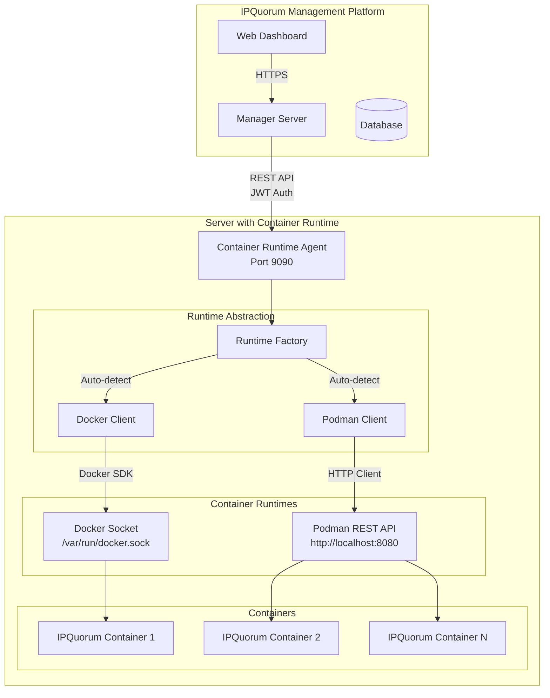
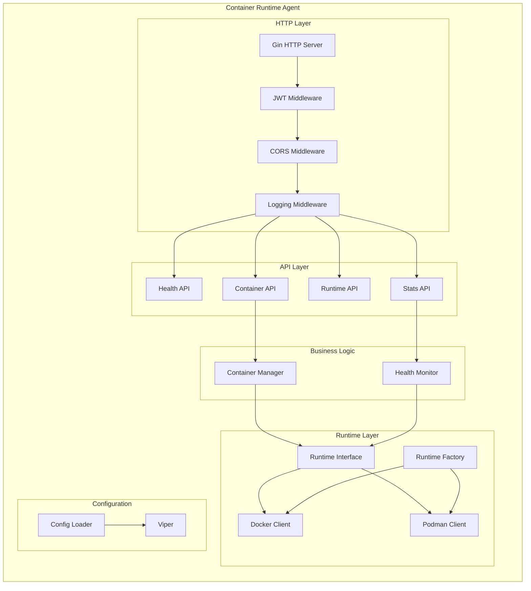
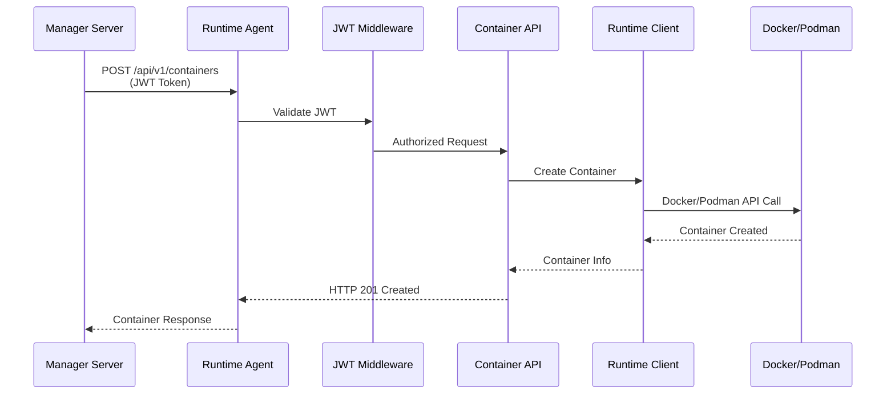
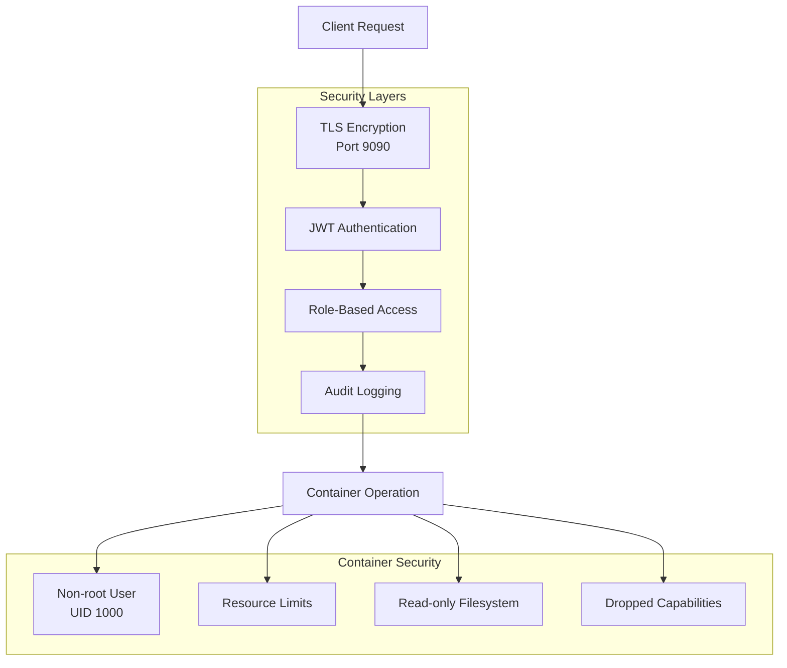
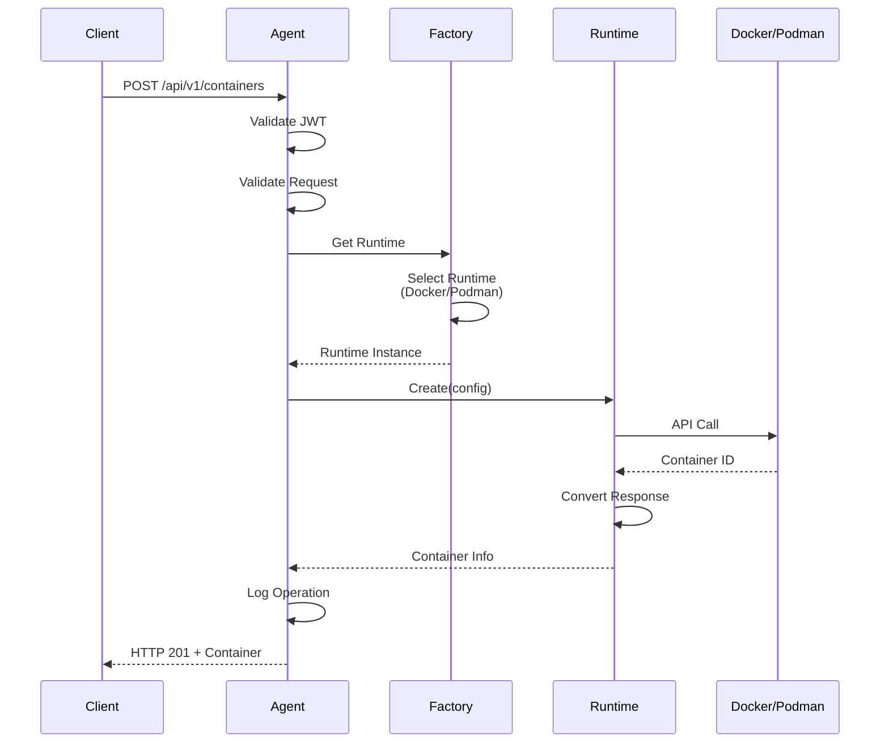
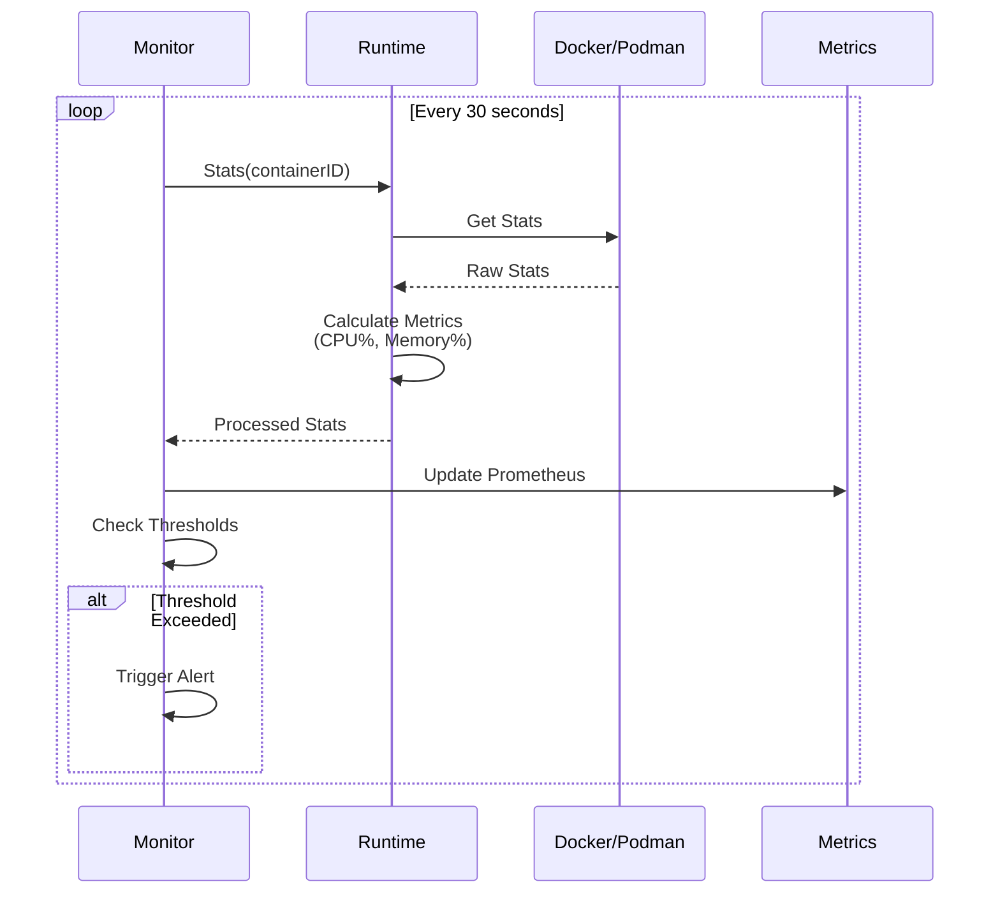
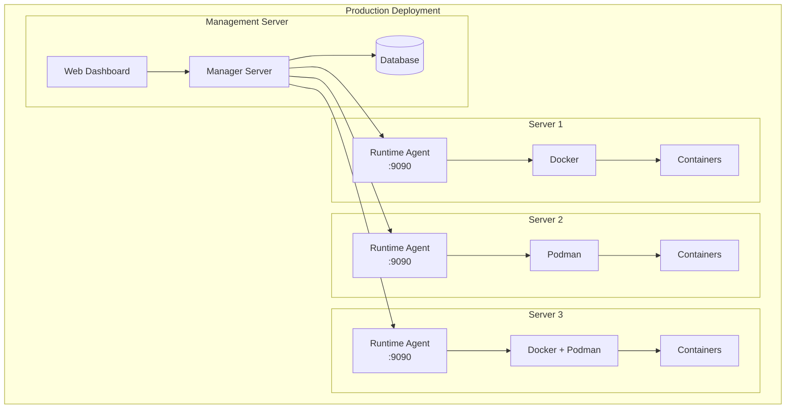
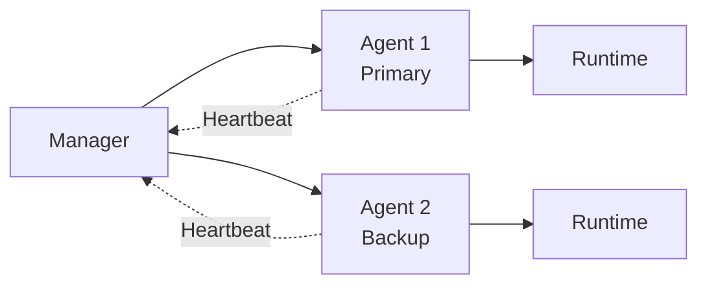

# Container Runtime Agent - Architecture Documentation

## 🎯 Overview

The Container Runtime Agent is a lightweight Go service that provides a unified REST API for managing Docker and Podman containers. It acts as an abstraction layer between the IPQuorum Management Platform and container runtimes.

## 🏗️ High-Level Architecture



## 📦 Component Architecture



## 🔄 Request Flow



## 📁 Directory Structure

```
container-runtime-agent/
├── cmd/
│   └── agent/
│       └── main.go                 # Application entry point
│
├── pkg/                            # Public packages
│   ├── runtime/                    # Runtime abstraction
│   │   ├── types.go               # Interface & type definitions
│   │   ├── docker.go              # Docker implementation
│   │   ├── podman.go              # Podman implementation
│   │   └── factory.go             # Runtime factory & detection
│   │
│   └── config/                     # Configuration
│       ├── config.go              # Config structures
│       └── loader.go              # Config loading logic
│
├── internal/                       # Private packages
│   ├── api/                       # HTTP API handlers
│   │   ├── health.go              # Health check endpoints
│   │   ├── containers.go          # Container management
│   │   ├── runtime.go             # Runtime info endpoints
│   │   └── stats.go               # Statistics endpoints
│   │
│   ├── middleware/                # HTTP middleware
│   │   ├── auth.go                # JWT authentication
│   │   ├── cors.go                # CORS handling
│   │   └── logging.go             # Request logging
│   │
│   └── manager/                   # Business logic
│       ├── container.go           # Container manager
│       └── monitor.go             # Health monitoring
│
├── configs/                        # Configuration files
│   ├── agent.yaml                 # Default configuration
│   └── agent.example.yaml         # Example configuration
│
├── scripts/                        # Utility scripts
│   ├── install.sh                 # Installation script
│   └── systemd/                   # Systemd service files
│       └── container-runtime-agent.service
│
├── docs/                          # Documentation
│   ├── ARCHITECTURE.md            # This file
│   ├── API.md                     # API documentation
│   └── DEPLOYMENT.md              # Deployment guide
│
├── go.mod                         # Go module definition
├── go.sum                         # Dependency checksums
├── Makefile                       # Build automation
└── README.md                      # Project overview
```

## 🔌 Runtime Interface

The core abstraction that enables support for multiple container runtimes:

```go
type Runtime interface {
    // Lifecycle operations
    Create(ctx context.Context, config *ContainerConfig) (*Container, error)
    Start(ctx context.Context, id string) error
    Stop(ctx context.Context, id string, timeout time.Duration) error
    Restart(ctx context.Context, id string, timeout time.Duration) error
    Remove(ctx context.Context, id string, force bool) error

    // Inspection operations
    Inspect(ctx context.Context, id string) (*Container, error)
    List(ctx context.Context, filters map[string]string) ([]*Container, error)

    // Monitoring operations
    Logs(ctx context.Context, id string, opts LogOptions) (io.ReadCloser, error)
    Stats(ctx context.Context, id string) (*Stats, error)

    // Health operations
    Ping(ctx context.Context) error
    Version(ctx context.Context) (*Version, error)
    Info(ctx context.Context) (*RuntimeInfo, error)

    // Runtime identification
    Name() string
    Type() RuntimeType
}
```

## 🐳 Docker Implementation

Uses the official Docker Go SDK:

```go
type DockerRuntime struct {
    client *client.Client
    logger *zap.Logger
}

// Connects via Unix socket
client.NewClientWithOpts(
    client.WithHost("unix:///var/run/docker.sock"),
    client.WithAPIVersionNegotiation(),
)
```

**Features:**
- Native Docker SDK integration
- Automatic API version negotiation
- Full container lifecycle support
- Real-time stats and logs
- Resource limit enforcement

## 🦭 Podman Implementation

Uses HTTP client for Podman REST API:

```go
type PodmanRuntime struct {
    baseURL string
    client  *http.Client
    logger  *zap.Logger
}

// Connects via HTTP or Unix socket
baseURL: "http://localhost:8080/v4.0.0/libpod"
// or
baseURL: "unix:///run/podman/podman.sock"
```

**Features:**
- Docker-compatible API
- Rootless container support
- HTTP/Unix socket connectivity
- Libpod-specific features
- Systemd integration

## 🔍 Runtime Detection

Automatic detection of available runtimes:

```go
func DetectRuntimes(config *Config, logger *zap.Logger) map[string]Runtime {
    runtimes := make(map[string]Runtime)
    
    // Try Docker
    if docker, err := NewDockerRuntime(config.Docker.Socket, logger); err == nil {
        if docker.Ping(context.Background()) == nil {
            runtimes["docker"] = docker
        }
    }
    
    // Try Podman
    if podman, err := NewPodmanRuntime(config.Podman.Socket, logger); err == nil {
        if podman.Ping(context.Background()) == nil {
            runtimes["podman"] = podman
        }
    }
    
    return runtimes
}
```

## 🔐 Security Architecture



### Security Features

1. **Transport Security**
   - TLS 1.2+ encryption
   - Certificate-based authentication
   - Mutual TLS (optional)

2. **Authentication**
   - JWT token-based auth
   - Token expiration
   - Refresh token support

3. **Authorization**
   - Role-based access control
   - Operation-level permissions
   - Resource-level permissions

4. **Container Security**
   - Non-root execution
   - Resource limits (CPU, memory)
   - Read-only root filesystem
   - Dropped Linux capabilities
   - Security profiles (AppArmor/SELinux)

5. **Audit & Logging**
   - All operations logged
   - Structured logging (JSON)
   - Log rotation
   - Centralized logging support

## 📊 Data Flow

### Container Creation Flow



### Stats Collection Flow



## 🔧 Configuration

### Configuration Hierarchy

```
1. Default values (hardcoded)
2. Configuration file (/etc/ipquorum/agent.yaml)
3. Environment variables (AGENT_*)
4. Command-line flags (--flag)
```

### Configuration Structure

```yaml
agent:
  listen_addr: "0.0.0.0"
  listen_port: 9090
  tls_enabled: true
  cert_file: /etc/ipquorum/certs/agent.crt
  key_file: /etc/ipquorum/certs/agent.key
  jwt_secret: "${JWT_SECRET}"

runtime:
  auto_detect: true
  preferred: "podman"
  
  docker:
    enabled: true
    socket: /var/run/docker.sock
    
  podman:
    enabled: true
    socket: /run/podman/podman.sock
    api_url: "http://localhost:8080"

logging:
  level: info
  format: json
  output: /var/log/ipquorum/agent.log

monitoring:
  enabled: true
  interval: 30s
  prometheus_port: 9091
```

## 🚀 Deployment Architecture



## 📈 Scalability

### Horizontal Scaling

- **Multiple Agents**: Deploy agent on each server
- **Load Balancing**: Manager distributes containers across agents
- **Independent**: Each agent manages its local runtime
- **No Shared State**: Agents are stateless

### Vertical Scaling

- **Resource Limits**: Configure per-container limits
- **Runtime Selection**: Choose Docker or Podman based on load
- **Monitoring**: Track resource usage and adjust

## 🔄 High Availability

### Agent Redundancy



### Failure Handling

1. **Agent Failure**: Manager detects via heartbeat, marks agent offline
2. **Runtime Failure**: Agent detects via ping, attempts restart
3. **Container Failure**: Restart policy handles automatic recovery
4. **Network Failure**: Retry logic with exponential backoff

## 🎯 Performance Considerations

### Optimization Strategies

1. **Connection Pooling**: Reuse HTTP connections
2. **Caching**: Cache runtime info and version
3. **Async Operations**: Non-blocking container operations
4. **Batch Operations**: Support bulk container management
5. **Streaming**: Stream logs instead of buffering

### Resource Usage

- **Memory**: ~20-50MB per agent
- **CPU**: <5% idle, <20% under load
- **Network**: Minimal (local socket/HTTP)
- **Disk**: Logs only (~100MB with rotation)

## 📚 Related Documentation

- [API Documentation](API.md) - REST API reference
- [Deployment Guide](DEPLOYMENT.md) - Installation and setup
- [Phase 1 Status](PHASE1-STATUS.md) - Current implementation status
- [Testing Guide](TESTING.md) - Testing procedures

## 🔗 External References

- [Docker Engine API](https://docs.docker.com/engine/api/)
- [Podman REST API](https://docs.podman.io/en/latest/_static/api.html)
- [Gin Web Framework](https://gin-gonic.com/)
- [Zap Logger](https://github.com/uber-go/zap)